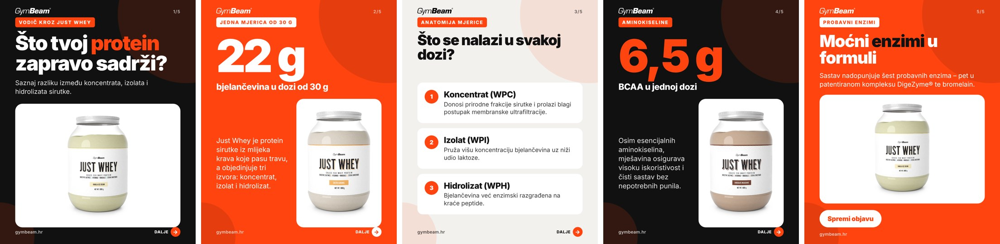

# GymBeam Hrvatska – tri gotove objave

Instagram: @gymbeamhr · web: https://gymbeam.hr

## Objava 1 – Vodič kroz Just Whey: Što tvoj protein zapravo sadrži?

- **Format:** karusel (5 kadr.)
- **Cilj:** Edukacija koja se sprema i dijeli (spremanja, dijeljenja) (mjera: Spremanja i dijeljenja objave)
- **Koncept:** Edukativni karusel koji korak po korak objašnjava razliku između koncentrata, izolata i hidrolizata sirutke u Just Whey proteinu. Posljednji slajdovi naglašavaju ulogu probavnih enzima DigeZyme® i bromelaina.
- **Zašto odgovara brendu:** Rekreativci i početnici često nisu sigurni kako odabrati protein i zabrinuti su zbog teške probavljivosti. Edukativni sadržaj s konkretnim brojkama i objašnjenjem probavnih enzima idealan je za spremanje i dijeljenje unutar fitness zajednice.
- **AI ocjene provjere:** {"brend": 10, "jasnoca": 10, "cilj": 10, "jezik": 10, "cinjenice": 10}



**Kadrovi:** [kadar_01.png](objava_1/kadar_01.png), [kadar_02.png](objava_1/kadar_02.png), [kadar_03.png](objava_1/kadar_03.png), [kadar_04.png](objava_1/kadar_04.png), [kadar_05.png](objava_1/kadar_05.png)

**Opis objave (caption):**

```
Nisi siguran što tvoj protein zapravo sadrži? Vrijeme je da zaviriš ispod etikete! 🔍

Just Whey je naš protein sirutke iz mlijeka krava koje pasu travu, a kombinira čak tri izvora bjelančevina: koncentrat, izolat i hidrolizat. U jednoj mjerici od 30 g čeka te najmanje 22 g bjelančevina i 6,5 g BCAA – bez punila i zgušnjivača.

Sastav nadopunjuje šest probavnih enzima: pet u kompleksu DigeZyme® te bromelain.

Spremi ovaj vodič da ti se nađe pri ruci sljedeći put kad biraš protein i pošalji ga prijatelju iz teretane! 💪

Pakiranje od 500 g: 26,95 € (cijena na gymbeam.hr, 25.11.2026.).

#gymbeam #gymbeamhr #justwhey #proteini #fitnesshrvatska #vjezbanje #prehrana
```

**Alt tekstovi:**

1. Prozirna ambalaža Just Whey proteina okusa Vanilla Ice Cream s prikazom glavnih svojstava na etiketi.
2. Ambalaža Just Whey proteina okusa Salted Caramel uz istaknutu količinu bjelančevina.
3. Grafički prikaz triju izvora proteina sirutke u Just Whey mješavini.
4. Ambalaža Just Whey proteina okusa Chocolate Milkshake.
5. Just Whey protein s istaknutim enzimima DigeZyme i pozivom na spremanje objave.

**Korištene činjenice i izvori:**

- Just Whey je protein sirutke iz triju izvora bjelančevina – koncentrata, izolata i hidrolizata. — https://gymbeam.hr/protein-just-whey-gymbeam.html
- U dozi od 30 g sadrži najmanje 22 g bjelančevina i 6,5 g BCAA. — https://gymbeam.hr/protein-just-whey-gymbeam.html
- Obogaćen je kompleksom probavnih enzima DigeZyme® i bromelainom. — https://gymbeam.hr/protein-just-whey-gymbeam.html

**Opcionalni prompt za AI scenu (ChatGPT/Gemini, ručno):** Clean modern gym aesthetic with dark background, minimalist orange and white gym elements, high contrast, professional sports nutrition style

## Objava 2 – Slano ili slatko nakon kasnog treninga?

- **Format:** slika (1 kadr.)
- **Cilj:** Više komentara i interakcije zajednice (mjera: Broj komentara i glasanja u raspravi)
- **Koncept:** Grafički podijeljen vizual u GymBeam bojama s velikim napisom 'SLANO VS. SLATKO'. Na lijevoj strani nalazi se fotografija Proteinskog čipsa, a na desnoj MoiMüv Proteinski namaz. U opisu pozivamo pratitelje da u komentarima napišu koji su tim nakon večernjeg treninga.
- **Zašto odgovara brendu:** Vječna dilema između slanog i slatkog pridonosi visokoj stopi angažmana (engagement rate). Post postavlja jednostavno pitanje koje potiče brzu reakciju i komentare pratitelja bez prodajnog pritiska.
- **AI ocjene provjere:** {"brend": 10, "jasnoca": 10, "cilj": 10, "jezik": 10, "cinjenice": 10}


**Kadrovi:** [kadar_01.png](objava_2/kadar_01.png)

**Opis objave (caption):**

```
Odradio si naporan večernji trening, istuširao se i stigao doma – i sad kreće vječna rasprava sa samim sobom.

Biraš li nešto slano i hrskavo ili kremasto i slatko?

Ekipa A: Proteinski čips priprema se ekspandiranjem vrućim zrakom, sadrži manje od 10 % masti i donosi do 8,4 g proteina po vrećici. Savršen za hrskanje bez grižnje savjesti.

Ekipa B: MoiMüv Proteinski namaz s mekanom kremastom teksturom koja se topi na jeziku. Izvor je proteina, a ne sadrži dodani šećer – idealan na rižinim krekerima ili ravno na žlicu.

Nema krivog odgovora, ali nas zanima: jesi li večeras Tim A ili Tim B?

Napiši svoje slovo u komentar! 👇

#gymbeam #gymbeamhr #fitnesshrvatska #proteinskisnack #fitrecepti #snacktime #trening
```

**Alt tekstovi:**

1. Grafički podijeljen vizual s natpisom Slano ili slatko: na opciji A nalazi se GymBeam Proteinski čips s morskom soli, a na opciji B MoiMüv proteinski namaz od lješnjaka.

**Korištene činjenice i izvori:**

- Proteinski čips priprema se ekspandiranjem vrućim zrakom i sadrži manje od 10 % masti. — https://gymbeam.hr/proteinski-chips-gymbeam.html
- Proteinski namaz MoiMüv izvor je proteina i ne sadrži dodani šećer. — https://gymbeam.hr/proteinski-namaz-moimuv-gymbeam.html

**Opcionalni prompt za AI scenu (ChatGPT/Gemini, ručno):** Dark modern studio background with dynamic orange and charcoal gray lighting split in half down the center, subtle fitness atmosphere, clean and minimalist aesthetic, 8k resolution, no products, no text

## Objava 3 – Odbrojavanje do prosinca uz Adventski kalendar

- **Format:** story (4 kadr.)
- **Cilj:** Interes za kupnju sezonskog proizvoda (klik na link / posjet webshopu) (mjera: Broj klikova na stiker s poveznicom u Storyju)
- **Koncept:** Blagdanski Story niz koji stvara osjećaj iščekivanja prije 1. prosinca. Cadre po cadre prikazuje detalje pakiranja Adventskog kalendara, ističe 24 iznenađenja te završava s naljepnicom koja vodi izravno na kupnju na webshopu.
- **Zašto odgovara brendu:** Predbožićno razdoblje u kasnom studenom i početkom prosinca idealno je za promociju poklona. Story format s naljepnicom za poveznicu pruža najbrži put od interesa do posjeta webshopu.
- **AI ocjene provjere:** {"brend": 10, "jasnoca": 10, "cilj": 10, "jezik": 10, "cinjenice": 10}


**Kadrovi:** [kadar_01.png](objava_3/kadar_01.png), [kadar_02.png](objava_3/kadar_02.png), [kadar_03.png](objava_3/kadar_03.png), [kadar_04.png](objava_3/kadar_04.png)

**Opis objave (caption):**

```
Spreman za najslađe odbrojavanje do Božića? 🎄

GymBeam Adventski kalendar skriva 24 iznenađenja! Iza prozorčića te čekaju naši najpopularniji proizvodi – proteinske pločice, keksi i druge poslastice, ali i šejker, vitamini i napitci.

Savršen dar za tebe ili dragu osobu koja voli aktivan životni stil. 🎁

⚠️ Kalendara ima samo ograničen broj, stoga ne čekaj posljednji trenutak.

Cijena: 81,95 € (na gymbeam.hr, 25.11.2026.)

Klikni na poveznicu u Storyju i osiguraj svoj kalendar!

#gymbeam #gymbeamhr #adventskikalendar #fitnesspoklon #poklon #bozic2026
```

**Alt tekstovi:**

1. Prednja i bočna strana zelene kutije GymBeam Adventskog kalendara s blagdanskim natpisima. — naljepnica: {'tip': 'anketa', 'pitanje': 'Kada otvaraš prozorčić?', 'opcije': ['Odmah ujutro', 'Nakon treninga']}
2. Rastvoreni crveno-bijeli adventski kalendar s numeriranim pretincima od 1 do 24.
3. Zelena i crvena kutija GymBeam adventskog kalendara u zatvorenom i otvorenom izdanju.
4. Šareno rastvoreni Adventski kalendar s numeriranim prozorčićima i fitness motivima. — naljepnica: {'tip': 'link', 'tekst': 'KUPI KALENDAR', 'url': 'https://gymbeam.hr/advent-kalendar-gymbeam.html'}

**Korištene činjenice i izvori:**

- Adventski kalendar GymBeam skriva 24 iznenađenja s najpopularnijim proizvodima. — https://gymbeam.hr/advent-kalendar-gymbeam.html
- Radi se o ograničenoj seriji sezonskog proizvoda. — https://gymbeam.hr/advent-kalendar-gymbeam.html
- Dimenzije kalendara su 45 × 32 × 22 cm. — https://gymbeam.hr/advent-kalendar-gymbeam.html
- Cijena iznosi 81.95 EUR. — https://gymbeam.hr/advent-kalendar-gymbeam.html

**Opcionalni prompt za AI scenu (ChatGPT/Gemini, ručno):** Cozy festive background with subtle dark wood texture, warm Christmas lights softly blurred in the backdrop, minimalist orange and black holiday decorations, aesthetic high-end product showcase style, clean background without any text or products.
