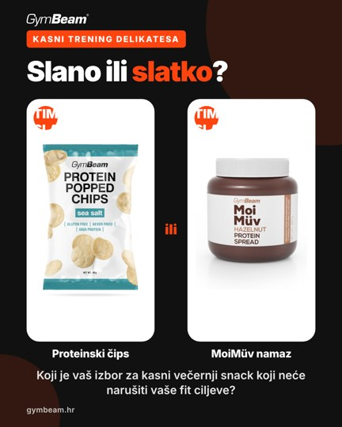
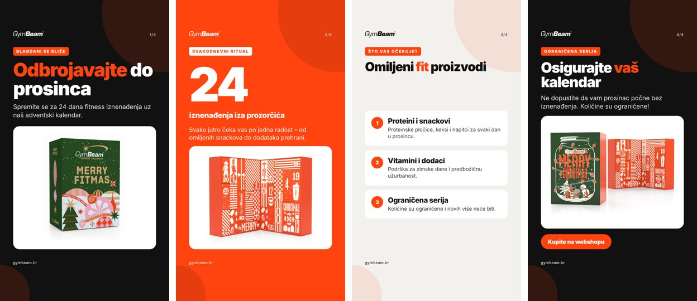

# GymBeam Hrvatska – tri gotove objave

Instagram: @gymbeamhr · web: https://gymbeam.hr

## Objava 1 – Vodič kroz Just Whey: Što tvoj protein zapravo sadrži?

- **Format:** karusel (5 kadr.)
- **Cilj:** Edukacija koja se sprema i dijeli (spremanja, dijeljenja) (mjera: Spremanja i dijeljenja objave)
- **Koncept:** Edukativni karusel koji korak po korak objašnjava razliku između koncentrata, izolata i hidrolizata sirutke u Just Whey proteinu. Posljednji slajdovi naglašavaju ulogu probavnih enzima DigeZyme® i bromelaina.
- **Zašto odgovara brendu:** Rekreativci i početnici često nisu sigurni kako odabrati protein i zabrinuti su zbog teške probavljivosti. Edukativni sadržaj s konkretnim brojkama i objašnjenjem probavnih enzima idealan je za spremanje i dijeljenje unutar fitness zajednice.
- **AI ocjene provjere:** {"brend": 10, "jasnoca": 10, "cilj": 10, "jezik": 10, "cinjenice": 10}


**Kadrovi:** [kadar_01.png](objava_1/kadar_01.png), [kadar_02.png](objava_1/kadar_02.png), [kadar_03.png](objava_1/kadar_03.png), [kadar_04.png](objava_1/kadar_04.png), [kadar_05.png](objava_1/kadar_05.png)

**Opis objave (caption):**

```
Znate li što se sve nalazi u vašoj mjerici proteina? Šejk nakon treninga standardan je dio fitness rutine, ali sastav proteina česta je enigma.

GymBeam Just Whey objedinjuje tri izvora bjelančevina sirutke u jednoj mjerici:
- Koncentrat (WPC) koji donosi prirodne frakcije sirutke,
- Izolat (WPI) s višom koncentracijom bjelančevina i nižim udjelom laktoze,
- Hidrolizat (WPH) koji je enzimski razgrađen na kraće peptide.

U jednoj dozi od 30 g dobivate najmanje 22 g bjelančevina, 6,5 g BCAA i puni spektar esencijalnih aminokiselina. Formulacija je obogaćena s pet probavnih enzima u kompleksu DigeZyme® te bromelainom – enzimom dobivenim iz ananasa. Dodani su i cink, magnezij te vitamini B6 i E.

Spremite ovu objavu kako biste imali vodič pri ruci pri sljedećem odabiru i podijelite je s prijateljima iz teretane! Koji okus Just Whey proteina je vaš favorit? Napišite nam u komentarima.

#gymbeam #justwhey #proteini #sportskaprehrana #teretana #fitnesshrvatska #prehrana
```

**Alt tekstovi:**

1. Ambalaža GymBeam Just Whey proteina s okusom vanilije na tamnoj pozadini s narančastim naglascima.
2. Svijetli slajd s prikazom triju izvora bjelančevina u Just Whey proteinu: koncentrat, izolat i hidrolizat.
3. Narančasti slajd s velikim brojem 22 g i prikazom Just Whey proteina s okusom čokolade.
4. Svijetli slajd s objašnjenjem DigeZyme kompleksa i bromelaina u sastavu Just Whey proteina.
5. Tamni slajd s ambalažom Just Whey Salted Caramel i gumbom za spremanje objave.

**Korištene činjenice i izvori:**

- Just Whey je protein sirutke iz triju izvora bjelančevina – koncentrata, izolata i hidrolizata. — https://gymbeam.hr/protein-just-whey-gymbeam.html
- U dozi od 30 g sadrži najmanje 22 g bjelančevina i 6,5 g BCAA. — https://gymbeam.hr/protein-just-whey-gymbeam.html
- Obogaćen je kompleksom probavnih enzima DigeZyme® i bromelainom. — https://gymbeam.hr/protein-just-whey-gymbeam.html

## Objava 2 – Slano ili slatko nakon kasnog treninga?

- **Format:** slika (1 kadr.)
- **Cilj:** Više komentara i interakcije zajednice (mjera: Broj komentara i glasanja u raspravi)
- **Koncept:** Grafički podijeljen vizual u GymBeam bojama s velikim napisom 'SLANO VS. SLATKO'. Na lijevoj strani nalazi se fotografija Proteinskog čipsa, a na desnoj MoiMüv Proteinski namaz. U opisu pozivamo pratitelje da u komentarima napišu koji su tim nakon večernjeg treninga.
- **Zašto odgovara brendu:** Vječna dilema između slanog i slatkog pridonosi visokoj stopi angažmana (engagement rate). Post postavlja jednostavno pitanje koje potiče brzu reakciju i komentare pratitelja bez prodajnog pritiska.
- **AI ocjene provjere:** {"brend": 9, "jasnoca": 9, "cilj": 10, "jezik": 10, "cinjenice": 10}



**Kadrovi:** [kadar_01.png](objava_2/kadar_01.png)

**Opis objave (caption):**

```
Završili ste kasni trening i otvarate kuhinjske ormariće. Što prvo birate – hrskavo slano ili kremasto slatko?

Vječna dilema nakon večernjeg treninga ne mora značiti kompromis s vašim fit ciljevima. Za vas smo pripremili dvije odlične opcije:

Ako ste u Timu Slano, tu je Proteinski čips. Priprema se ekspandiranjem vrućim zrakom i sadrži manje od 10 % masti, pa možete uživati u hrskanju bez brige.

Ako ipak glasate za Tim Slatko, vaš favorit je MoiMüv Proteinski namaz. Izvor je proteina i ne sadrži dodani šećer, a odlično se uklapa na palačinke, tost ili direktno na žlicu.

Nema krivog odgovora! Napišite nam u komentarima – jeste li Tim Slano ili Tim Slatko?

#gymbeam #gymbeamhr #fitprehrana #proteinskicips #moimuv #fitnesshrvatska #zdravisnack #slanoilislatko
```

**Alt tekstovi:**

1. Grafički podijeljen kadar na tamnoj pozadini. S lijeve strane je prikazan GymBeam Proteinski čips (Tim Slano), a s desne strane MoiMüv Proteinski namaz (Tim Slatko).

**Korištene činjenice i izvori:**

- Proteinski čips priprema se ekspandiranjem vrućim zrakom i sadrži manje od 10 % masti. — https://gymbeam.hr/proteinski-chips-gymbeam.html
- Proteinski namaz MoiMüv izvor je proteina i ne sadrži dodani šećer. — https://gymbeam.hr/proteinski-namaz-moimuv-gymbeam.html

**Opcionalni prompt za AI scenu (ChatGPT/Gemini, ručno):** A clean, split background visual with dark matte texture on the left and bright brand orange gradient on the right, modern minimalist aesthetic, studio lighting, high resolution, no products, no text.

## Objava 3 – Odbrojavanje do prosinca uz Adventski kalendar

- **Format:** story (4 kadr.)
- **Cilj:** Interes za kupnju sezonskog proizvoda (klik na link / posjet webshopu) (mjera: Broj klikova na stiker s poveznicom u Storyju)
- **Koncept:** Blagdanski Story niz koji stvara osjećaj iščekivanja prije 1. prosinca. Cadre po cadre prikazuje detalje pakiranja Adventskog kalendara, ističe 24 iznenađenja te završava s naljepnicom koja vodi izravno na kupnju na webshopu.
- **Zašto odgovara brendu:** Predbožićno razdoblje u kasnom studenom i početkom prosinca idealno je za promociju poklona. Story format s naljepnicom za poveznicu pruža najbrži put od interesa do posjeta webshopu.
- **AI ocjene provjere:** {"brend": 10, "jasnoca": 10, "cilj": 10, "jezik": 8, "cinjenice": 10}



**Kadrovi:** [kadar_01.png](objava_3/kadar_01.png), [kadar_02.png](objava_3/kadar_02.png), [kadar_03.png](objava_3/kadar_03.png), [kadar_04.png](objava_3/kadar_04.png)

**Opis objave (caption):**

```
Jingle Bells, Jingle Bells... Božić se brzo bliži, a Vi imate 24 razloga za veselje! 🎄✨

Predstavljamo Vam GymBeam Adventski kalendar koji iza svakog od 24 prozorčića skriva iznenađenje za svaki prosinac do Badnjaka. Unutra Vas čekaju naši najpopularniji proizvodi – od proteinskih pločica i hrskavih keksa do vitamina i dodataka prehrani koji će Vam dobro doći u predbožićnoj užurbanosti.

Ovo je ograničena serija i novih količina više neće biti. Ne dopustite da Vam prosinac počne bez Vašeg jutarnjeg fitness rituala!

Kliknite na poveznicu u Storyju i osigurajte svoj kalendar na vrijeme. 🎁

#gymbeam #gymbeamhrvatska #adventskikalendar #fitbozic #fitnessprehrana #dodaciprehrani
```

**Alt tekstovi:**

1. Prikaz zelene kutije GymBeam adventskog kalendara s natpisom Merry Fitmas. — naljepnica: {'vrsta': 'anketa', 'pitanje': 'Jeste li spremni za advent?', 'opcije': ['Pretspreman/na!', 'Jedva čekam!']}
2. Rastvoreni crveno-bijeli adventski kalendar s 24 numerirana pretinca.
3. Grafički prikaz tri ključne značajke sadržaja adventskog kalendara.
4. Zelena kutija GymBeam adventskog kalendara uz otvoreni kalendar. — naljepnica: {'vrsta': 'link', 'tekst': 'Kupi kalendar', 'url': 'https://gymbeam.hr/advent-kalendar-gymbeam.html'}

**Korištene činjenice i izvori:**

- Adventski kalendar GymBeam skriva 24 iznenađenja s najpopularnijim proizvodima. — https://gymbeam.hr/advent-kalendar-gymbeam.html
- Radi se o ograničenoj seriji sezonskog proizvoda. — https://gymbeam.hr/advent-kalendar-gymbeam.html

**Opcionalni prompt za AI scenu (ChatGPT/Gemini, ručno):** Cozy festive holiday background with soft bokeh Christmas lights, pine branches, and subtle dark wood texture, minimalist studio aesthetic, dark warm tone.
